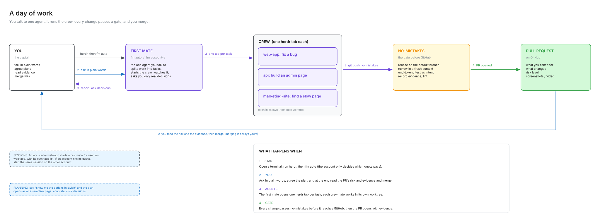
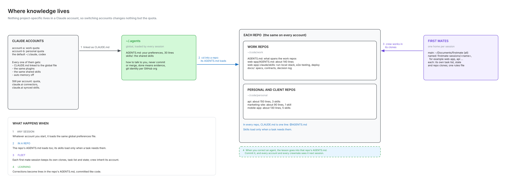
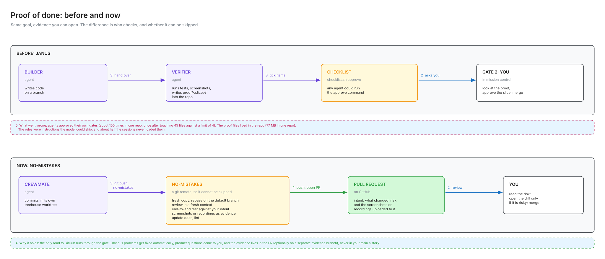
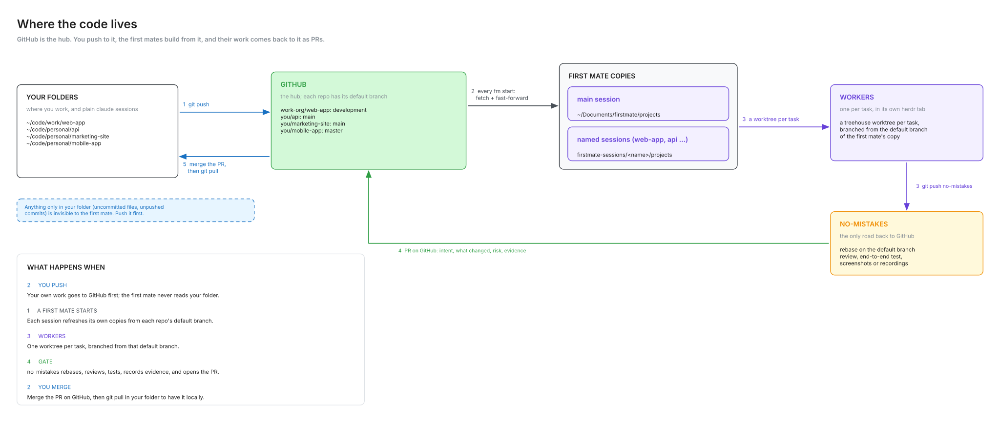

# bosun

bosun is my personal setup for a fleet of Claude Code agents. It runs on top of
[firstmate](https://github.com/kunchenguid/firstmate). You talk to one agent, the first mate.
The first mate splits the work into tasks and gives each task to a worker in its own clean copy of
the repo. Each change goes through a review gate, and you get a pull request with evidence.

bosun solves the problems that I found when I ran this fleet every day on more than one Claude
account. Agents spent tokens when they polled status commands in a loop. Workers started their own
sub-agents. Every task ran on the most expensive model. One account ran out of quota while the other
account had room. bosun adds the scripts, hooks, dispatch rules and standing rules that stop these
problems, and the docs that tell you when to use the fleet and when to work directly.

## Credit

bosun is a personal setup on top of **firstmate** by Kun Chen
(<https://github.com/kunchenguid/firstmate>, MIT licence). bosun does not contain firstmate's code.
Install firstmate from its own repo. firstmate keeps its own licence. The licence of this repo
(see [LICENSE](LICENSE)) covers only the content of this repo.

## What is in the repo

| Folder or file | What it holds |
|---|---|
| `bin/fm` | Starts a first mate on a Claude account, with a named session and its own home. |
| `bin/claude-acct` | Picks the account with the most quota left, and shows the use of every account. |
| `bin/claude-nm` | The `claude` binary for the no-mistakes gate. It puts each new gate session on the account with the most room. |
| `bin/wt` | Lists the worktrees of a project and shows the changes of one worktree as a pull-request page. It only reads. |
| `share/wt/review.html` | The page template that `wt` uses. It has a VS Code look, in light and dark. |
| `bin/gn` | Starts a gnhf overnight loop with caps on iterations, tokens and the wait for a rate limit. It does not start when every account is near its weekly limit. |
| `gnhf/config.example.yml` | The gnhf config. It sends each loop step through `claude-nm` on Sonnet. |
| `hooks/agent-poll-guard` | A PreToolUse hook. It stops an agent that polls a status command in a loop. |
| `hooks/crew-tool-guard` | A PreToolUse hook. It stops a worker that tries to start sub-agents or workflows. |
| `hooks/settings.example.json` | The hook wiring to merge into the `settings.json` of each account. |
| `statusline/statusline-command.sh` | The status line. It shows the branch, the model, the context use and the quota of every account. It also writes the quota file that `claude-acct` reads. |
| `firstmate/crew-dispatch.example.json` | Dispatch rules. They give each task a model and an effort level. |
| `firstmate/brief-include.example.md` | Standing rules that go into the brief of every worker. |
| `agent-instructions.example.md` | An example of global agent preferences, for `~/.agents/AGENTS.md`. |
| `docs/workflow.md` | How I use the fleet: when to use it, a day of work, where knowledge lives, proof, and lessons. |
| `docs/diagrams/` | The diagrams. Each `.py` file makes one `.svg` and one `.excalidraw` file. |

## How it works

**One first mate per session.** `fm <account> <session>` starts a first mate. Each session name gets
its own firstmate home under `$BOSUN_FM_SESSIONS/<name>`, because two first mates cannot share one
home. If the name matches a project, the session works only on that project and takes over the
queued tasks of that project from the main task list. A name that matches no project gets all
projects. The same name always brings back the same session, on any account. The account decides
only which quota pays.

`fm <account> <session> --subagents` lets that one first mate start harness sub-agents. Use it
when the work is not on a registered project, for example a browser task with no git repo, because
firstmate cannot make a worker worktree there. It sets `FM_ALLOW_SUBAGENT=1` for that session only.

**A worktree per worker.** firstmate gives each worker its own worktree, so tasks that run at the
same time never touch the same files. Workers build from what is on GitHub, not from your local
folder. Push first. `wt` lets you look at the changes of a worker before the pull request exists,
and it never writes to the worktree.

**Dispatch rules pick the model and the effort.** `crew-dispatch.example.json` has three rules. A
mechanical edit with no judgement runs on Sonnet at low effort. Simple work with a full
specification runs on Sonnet at medium effort. Work that needs judgement (architecture, security,
data migrations, a bug with an unknown cause) runs on Opus at high effort. The default is Sonnet at
high effort. The first mate itself runs on Opus with a 160k compact window, and no session gets the
1M window.

**Hooks stop polling and sub-agents.** Each turn re-reads the whole context, so a turn that only
waits is expensive. `agent-poll-guard` counts status calls by class in a 10-minute window and blocks
a loop around a status command at once. It tells the agent the one blocking command to use instead
(`no-mistakes axi run`, `gh pr checks <pr> --watch` or `gh run watch`). `crew-tool-guard` blocks the
Agent, Task, Workflow, TaskCreate and SendMessage tools in every session whose working directory is
in a crew worktree. Direct sessions keep these tools. Both hooks block with exit code 2 and give the
reason.

**Quota-aware account choice.** The status line of each session writes the live rate limits of its
account to `<config dir>/.quota-cache.json`. `claude-acct pick` reads these files and prints the
account with the most room. It skips an account at 97% or more of its 7-day limit. A reading older
than 45 minutes counts as unknown. `fm auto <session>` uses `claude-acct pick`. `claude-nm` does the
same for every new session of the review gate. A resumed session stays on the account that holds
it.

## Install

These steps are for macOS. Most scripts also work on Linux, but `wt` uses `open`, `opendiff` and
`lsof`.

1. Install the requirements: `bash`, `git`, `jq`, `python3` and Claude Code. Then install firstmate
   and its tools (herdr, treehouse and no-mistakes) as the firstmate README tells you.
2. Make one Claude config dir for each account, for example `~/.claude-account-a` and
   `~/.claude-account-b`. Log in once in each one with
   `CLAUDE_CONFIG_DIR=~/.claude-account-a claude`.
3. Clone bosun, for example to `~/code/bosun`. Link the scripts into a folder on your `PATH`:

   ```sh
   mkdir -p ~/.local/bin ~/.local/share/wt
   ln -s ~/code/bosun/bin/* ~/code/bosun/hooks/agent-poll-guard ~/code/bosun/hooks/crew-tool-guard ~/.local/bin/
   cp ~/code/bosun/share/wt/review.html ~/.local/share/wt/review.html
   ```

4. Set the env vars in your shell profile. Only `BOSUN_ACCOUNTS` is necessary when your folders
   are the same as the defaults.

   | Variable | What it sets | Default |
   |---|---|---|
   | `BOSUN_ACCOUNTS` | The account pool: Claude config dirs, separated by spaces. | `$HOME/.claude-account-a $HOME/.claude-account-b` |
   | `BOSUN_FM_HOME` | The firstmate checkout (the main home). | `$HOME/Documents/firstmate` |
   | `BOSUN_FM_SESSIONS` | The folder for the homes of named sessions. | `$HOME/Documents/firstmate-sessions` |
   | `BOSUN_CREW_ROOTS` | Folders where crew worktrees are, separated by colons. | `$HOME/.treehouse` |
   | `BOSUN_WORK_REMOTE_PATTERNS` | Globs on the `origin` URL of work repos, separated by spaces, for example `"*your-org/*"`. | empty (check off) |
   | `BOSUN_WORK_EMAIL_DOMAIN` | The email domain that work repos must use, for example `"@example.com"`. | empty (check off) |
   | `WT_ROOTS` | Folders that hold the clones for `wt`, separated by colons. Globs are permitted. | the `projects` folders of the firstmate homes |
   | `WT_TEMPLATE` | The page template for `wt`. | `~/.local/share/wt/review.html` |
   | `CLAUDE_NM_REAL` | The real `claude` binary for `claude-nm`. | `~/.local/bin/claude` |
   | `CLAUDE_ACCT_STALE_SECS` | The age in seconds after which a quota reading counts as unknown. | `2700` |
   | `FM_MODEL` | The model of the first mate. `--sonnet` on `fm` also sets it. | `opus` |
   | `FM_SUBAGENTS` | `1` lets the first mate start sub-agents. `--subagents` on `fm` also sets it. | `0` |
   | `GN_MAX_ITERATIONS`, `GN_MAX_TOKENS`, `GN_MAX_WAIT` | The caps that `gn` adds to a gnhf run. | `15`, `30000000`, `6h` |

   The status line shows "wrong git email" only when you set both `BOSUN_WORK_*` variables.

5. In the `settings.json` of each account, add the status line, the hooks and the context limit.
   Use the absolute path of your clone. Merge `hooks/settings.example.json` for the hooks.

   ```json
   {
     "statusLine": { "type": "command", "command": "/path/to/bosun/statusline/statusline-command.sh" },
     "env": { "CLAUDE_CODE_DISABLE_1M_CONTEXT": "1" }
   }
   ```

6. Copy the firstmate examples into the config folder of your firstmate checkout. Then change them
   as you need.

   ```sh
   cp ~/code/bosun/firstmate/crew-dispatch.example.json "$BOSUN_FM_HOME/config/crew-dispatch.json"
   cp ~/code/bosun/firstmate/brief-include.example.md "$BOSUN_FM_HOME/config/brief-include.md"
   ```

7. Copy `agent-instructions.example.md` to `~/.agents/AGENTS.md` and change it to your preferences.
   Link it into each account as `CLAUDE.md`, so that every account reads the same file:

   ```sh
   ln -s ~/.agents/AGENTS.md ~/.claude-account-a/CLAUDE.md
   ```

8. In the no-mistakes config, set `agent_path_override.claude` to the path of `claude-nm`. The gate
   then spreads its sessions over the accounts.
9. Optional: for overnight loops, install gnhf and copy `gnhf/config.example.yml` to
   `~/.gnhf/config.yml`. Set the path of `claude-nm` in it. Then start a run with `gn "<objective>"`.
10. Open herdr and run `fm auto` (or `fm account-a`). Run `fm acct` to see the quota of every account.

## Diagrams

The sources are in `docs/diagrams/`. To change a diagram, edit its `.py` file and run
`python3 <file>.py` in that folder. You can open each `.excalidraw` file at <https://excalidraw.com>.









## Related tools

- [watchkeeper](https://github.com/badman-returns/watchkeeper): a read-only viewer for the work of
  coding agents in every git worktree on your machine.
- [janus](https://github.com/badman-returns/janus): my earlier delivery workflow, a Claude Code plugin
  with orchestrated agents, approval gates and proof of done. bosun replaces it. `docs/workflow.md`
  tells why.
- [claude-kit](https://github.com/badman-returns/claude-kit): a toolkit of shared skills and plugins,
  and a bootstrap that links them into every Claude account.

## Licence

MIT. See [LICENSE](LICENSE). firstmate keeps its own licence.
