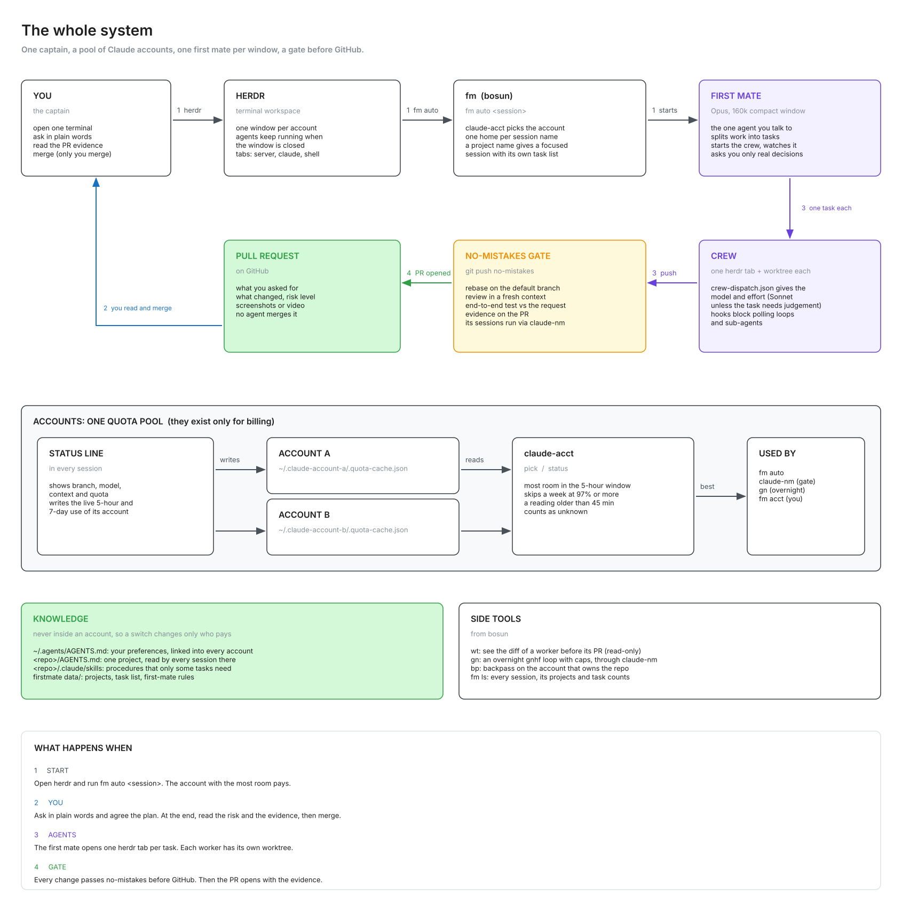

# Set up bosun

This page is the blueprint of the whole setup. It has the system diagram, the decisions to make,
a prompt that you give to your own Claude, the install steps and the checks. Your Claude can do
most of the steps for you. You must do the logins yourself.

The steps are for macOS. Most scripts also work on Linux, but `wt` uses `open`, `opendiff` and
`lsof`.

## The system



Read the diagram as a sequence:

1. You open a terminal and start **herdr**. herdr keeps agents running when you close the window.
   Use one herdr window for each Claude account.
2. In the window, you run `fm auto <session>`. `fm` asks `claude-acct` for the account with the most
   room and starts the **first mate** on it. Each session name has its own firstmate home. A session
   name that matches a project gives a first mate for that project only.
3. You tell the first mate what you want, in plain words. It splits the work into tasks and starts
   one **crew** worker for each task, in its own herdr tab and its own git worktree.
   `crew-dispatch.json` gives each worker a model and an effort level. Two hooks stop a worker that
   polls a status command in a loop or starts sub-agents.
4. Each worker pushes to the **no-mistakes gate**. The gate rebases the change, reviews it in a
   fresh context, tests it end to end against the request and opens a **pull request** with the
   evidence.
5. You read the risk and the evidence, and you merge. An agent never merges.

Under all of this, the **accounts are one quota pool**. The status line in each session writes the
live 5-hour and 7-day use of its account to `<config dir>/.quota-cache.json`. `claude-acct` reads
these files. `fm auto`, the gate (through `claude-nm`) and the overnight loop (`gn`) use its pick.
Knowledge never lives inside an account: your preferences are in `~/.agents/AGENTS.md`, and each
project has its own `AGENTS.md`. When you change the account, only the quota changes.

[workflow.md](workflow.md) tells how to use the setup every day.

## Decide first

Make these decisions before you start. Your Claude asks them in the first step of the prompt.

| Decision | Question | Default |
|---|---|---|
| Accounts | How many Claude accounts do you use, and what is the short name of each? Each account gets a config dir `~/.claude-<name>`. | `~/.claude-account-a`, `~/.claude-account-b` |
| Folders | Where do the firstmate checkout, the session homes and the bosun clone go? | `~/Documents/firstmate`, `~/Documents/firstmate-sessions`, `~/code/bosun` |
| Projects | Which GitHub repos does the first mate work on? | none |
| Work identity check | Which `origin` URLs are work repos, and which email domain must they use? The status line then warns about a wrong git email. | off |
| Overnight loops | Do you want gnhf for overnight loops (`gn`)? | no |
| Rule learning | Do you want backpass (`bp`)? Which folders belong to which account? | no |

## The prompt for your Claude

Open a terminal, start Claude Code on any of your accounts and paste this prompt:

```text
Set up bosun on this machine for me.

1. Clone https://github.com/badman-returns/bosun to ~/code/bosun (or to the folder I give you).
   Read docs/setup.md and README.md in full before you change anything.
2. Ask me each question in the "Decide first" table, one at a time. Show the default.
3. Do the steps in "Install" in order. Before you install software or change a settings.json,
   show me the command or the change.
4. Make a backup of each settings.json before you change it. Merge into it. Do not replace it.
5. When a step needs a login, stop and tell me the exact command to run myself.
6. Never print a token, a key or any other secret value.
7. After each step, run its check and tell me the result. If a check fails, fix it before the
   next step.
8. At the end, run every command in "Check the setup" and give me one report: what you did,
   what failed, and what I must do.
```

## Install

1. **Requirements.** Install `bash`, `git`, `jq`, `python3`, the GitHub CLI and Claude Code. Log in
   to GitHub with `gh auth login`.
   Check: `gh auth status` shows that you are logged in.

2. **Accounts.** Make one Claude config dir for each account. Log in once in each one. You must do
   this step yourself, because the login opens a browser:

   ```sh
   CLAUDE_CONFIG_DIR=~/.claude-account-a claude
   ```

   Check: each config dir has a `.claude.json` file.

3. **firstmate.** Clone firstmate into the folder of the main home. Select herdr as the backend
   before the first start. If you do not, firstmate uses tmux and offers to install tmux, not
   herdr. The `config/` folder is not in the clone, so make it.

   ```sh
   git clone https://github.com/kunchenguid/firstmate ~/Documents/firstmate
   mkdir -p ~/Documents/firstmate/config
   echo herdr > ~/Documents/firstmate/config/backend
   ```

   Then start Claude in the checkout once and say `ahoy`. The first mate checks its tools and asks
   before it installs herdr, treehouse and no-mistakes. Tell it which GitHub repos to add as
   projects.

   ```sh
   cd ~/Documents/firstmate && CLAUDE_CONFIG_DIR=~/.claude-account-a claude
   ```

   Check: `config/backend` contains `herdr`, and `data/projects.md` lists your projects.
   `herdr --version` and `no-mistakes --version` work.

4. **bosun scripts.** Clone bosun if you did not clone it yet. Link the scripts into a folder on
   your `PATH`:

   ```sh
   [ -d ~/code/bosun ] || git clone https://github.com/badman-returns/bosun ~/code/bosun
   mkdir -p ~/.local/bin ~/.local/share/wt
   ln -s ~/code/bosun/bin/* ~/code/bosun/hooks/agent-poll-guard ~/code/bosun/hooks/crew-tool-guard ~/.local/bin/
   cp ~/code/bosun/share/wt/review.html ~/.local/share/wt/review.html
   ```

   Check: `command -v fm claude-acct claude-nm wt gn bp` prints six paths.

5. **Env vars.** Set them in your shell profile. Only `BOSUN_ACCOUNTS` is necessary when your folders
   are the same as the defaults.

   | Variable | What it sets | Default |
   |---|---|---|
   | `BOSUN_ACCOUNTS` | The account pool: Claude config dirs, separated by spaces. | `$HOME/.claude-account-a $HOME/.claude-account-b` |
   | `BOSUN_FM_HOME` | The firstmate checkout (the main home). | `$HOME/Documents/firstmate` |
   | `BOSUN_FM_SESSIONS` | The folder for the homes of named sessions. | `$HOME/Documents/firstmate-sessions` |
   | `BOSUN_CREW_ROOTS` | Folders where crew worktrees are, separated by colons. | `$HOME/.treehouse` |
   | `BOSUN_WORK_REMOTE_PATTERNS` | Globs on the `origin` URL of work repos, separated by spaces, for example `"*your-org/*"`. | empty (check off) |
   | `BOSUN_WORK_EMAIL_DOMAIN` | The email domain that work repos must use, for example `"@example.com"`. | empty (check off) |
   | `WT_ROOTS` | Folders that hold the clones for `wt`, separated by colons. Globs are permitted. | the `projects` folders of the firstmate homes |
   | `WT_TEMPLATE` | The page template for `wt`. | `~/.local/share/wt/review.html` |
   | `CLAUDE_NM_REAL` | The real `claude` binary for `claude-nm`. | `~/.local/bin/claude` |
   | `CLAUDE_ACCT_STALE_SECS` | The age in seconds after which a quota reading counts as unknown. | `2700` |
   | `FM_MODEL` | The model of the first mate. `--sonnet` on `fm` also sets it. | `opus` |
   | `FM_SUBAGENTS` | `1` lets the first mate start sub-agents. `--subagents` on `fm` also sets it. | `0` |
   | `BP_ROOTS` | Folders that hold the clones for `bp <name>`, separated by colons. | the `projects` folder of `BOSUN_FM_HOME` |
   | `BP_ACCOUNT_RULES` | Rules `<path prefix>=<config dir>` for `bp`, separated by spaces. The first match wins. | empty (the first account) |
   | `GN_MAX_ITERATIONS`, `GN_MAX_TOKENS`, `GN_MAX_WAIT` | The caps that `gn` adds to a gnhf run. | `15`, `30000000`, `6h` |

   The status line shows "wrong git email" only when you set both `BOSUN_WORK_*` variables.
   Check: in a new terminal, `echo $BOSUN_ACCOUNTS` prints your config dirs.

6. **settings.json of each account.** Add the status line, the hooks and the context limit. Use the
   absolute path of your clone. Merge `hooks/settings.example.json` for the hooks.

   ```json
   {
     "statusLine": { "type": "command", "command": "/path/to/bosun/statusline/statusline-command.sh" },
     "env": { "CLAUDE_CODE_DISABLE_1M_CONTEXT": "1" }
   }
   ```

   Check: `jq .statusLine,.hooks,.env ~/.claude-account-a/settings.json` shows the three parts. Start
   one session on each account: the status line shows the quota, and the account now has a
   `.quota-cache.json` file.

7. **firstmate config.** Copy the examples into the config folder of your firstmate checkout. Then
   change them as you need.

   ```sh
   cp ~/code/bosun/firstmate/crew-dispatch.example.json "$BOSUN_FM_HOME/config/crew-dispatch.json"
   cp ~/code/bosun/firstmate/brief-include.example.md "$BOSUN_FM_HOME/config/brief-include.md"
   ```

   Check: `jq .default "$BOSUN_FM_HOME/config/crew-dispatch.json"` prints the default model.

8. **Your preferences.** Copy `agent-instructions.example.md` to `~/.agents/AGENTS.md` and change it
   to your preferences. Link it into each account as `CLAUDE.md`, so that every account reads the
   same file:

   ```sh
   mkdir -p ~/.agents && cp ~/code/bosun/agent-instructions.example.md ~/.agents/AGENTS.md
   ln -s ~/.agents/AGENTS.md ~/.claude-account-a/CLAUDE.md
   ```

   Check: `ls -l ~/.claude-*/CLAUDE.md` shows one link for each account.

9. **The gate.** In `~/.no-mistakes/config.yaml`, set `agent_path_override.claude` to the path of
   `claude-nm`. The gate then spreads its sessions over the accounts.

   ```yaml
   agent_path_override:
     claude: /Users/<you>/.local/bin/claude-nm
   ```

   Check: after the first gate run, `~/.no-mistakes/logs/claude-account.log` has one line for each
   gate session, with the account that took it.

10. **Optional: overnight loops.** Install gnhf and copy `gnhf/config.example.yml` to
    `~/.gnhf/config.yml`. Set the path of `claude-nm` in it. Then start a run with
    `gn "<objective>"`.

11. **Optional: rule learning.** Install backpass. Set `BP_ACCOUNT_RULES` when your repos belong to
    more than one account. Run `bp <repo>` every two weeks in your busiest repos.

## Check the setup

Run these commands. Each line tells what you must see.

| Command | You see |
|---|---|
| `fm nosuchaccount` | The usage line, with the names of your accounts: `usage: fm account-a\|account-b\|auto ...` |
| `fm acct` | One row for each account, with the 5-hour and 7-day use. |
| `claude-acct pick` | The config dir of the account with the most room. |
| `fm ls` | The `main` session and the projects of the main home. |
| `herdr`, then `fm auto` | A first mate starts on the picked account. Say `/ahoy`. |

Then give the first mate one small task, for example `ship: fix a typo in the README, one PR`. A
crew tab opens in herdr, the gate runs, and a pull request with evidence arrives. That pull request
is the proof that the full chain works.
