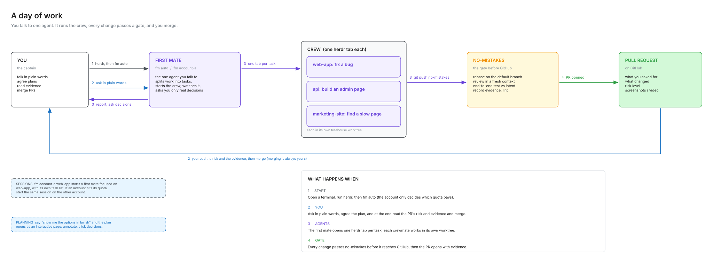
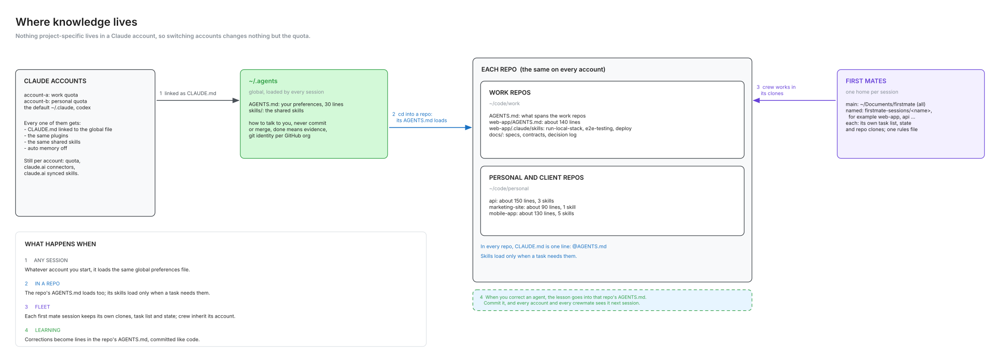
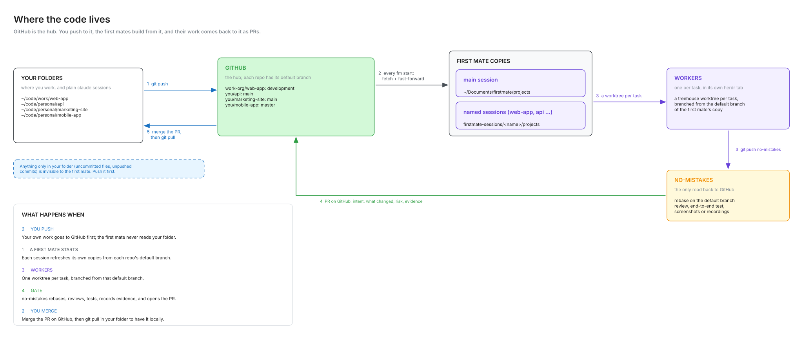
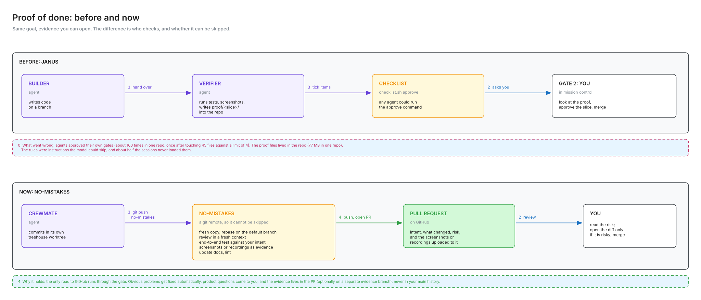

# How I work with the fleet

This page tells how I use bosun and firstmate every day. It tells which way of working to use for a
task, what a day of work looks like, where knowledge lives, how proof is recorded before a pull
request, and the lessons that made the rules. The project names (`web-app`, `api`) and the account
names (`account-a`, `account-b`) are examples.

Some words have one meaning on this page:

- **herdr** is a terminal workspace. Agents in it keep running when you close the window.
- **The first mate** is the one agent that you talk to in herdr. You start it with `fm`.
- **A crewmate** is a worker that the first mate starts for one task, in its own herdr tab and its
  own worktree. It ends in a pull request.
- **A scout** is a crewmate that writes a report and does not change code.
- **The gate** is no-mistakes. It is a git remote that reviews the change in a fresh context, tests
  it end to end, records evidence and then opens the pull request.
- **A direct session** is a plain Claude Code session that you start in a repo and watch.

## When to use the fleet and when to use a direct session

There are four ways of working. Select one for each piece of work.

| The work | The way | Why |
|---|---|---|
| A question, research or a comparison, with no repo | Plain chat | No repo to load. This is the smallest context. |
| One ticket that you watch, and you will read the pull request within the hour | Direct session in the repo | A crewmate starts a fresh context and the gate runs a full review. For a fix in one file, that costs more than the fix. |
| A batch of tickets, work on two projects at the same time, a scout or an audit, or a change that must go through the gate before you see it | The fleet: `ship:`, `scout:` or `queue:` to the first mate | You give the work and walk away. You read the pull request or the report later. |
| An open goal that an agent can improve step by step, with a stop condition | Overnight loop (gnhf) in the repo | It makes one small commit per step on its own branch and stops at a token cap or at the stop condition. |

**Rule of thumb: if you will read the PR within the hour, go direct; if you will read it tomorrow,
use the fleet.**

A direct session does not go through the gate. If a change touches auth, money, a data migration or
a shared backend, use the fleet, so that a fresh context reviews it first.

Something that touches a live client system needs an explicit go-ahead from you at that moment. No
way of working does this alone.

## A day of work

1. Open herdr. Use one herdr window for each account, for example `herdr --session work` and
   `herdr --session personal`. Each window has one first mate. Crew always open in the window of the
   first mate that started them.
2. In each window, give each project a workspace with three tabs: `server`, `claude` and `shell`.
   The dev server always runs in `server`, so you and every agent know where it runs. Give each
   project a fixed dev-server port, so that two projects never fight for the same port.
3. Start the first mate in its own workspace: `fm account-a`, or `fm auto` for the account with the
   most room. Your first message of the day is `/ahoy`. It tells you what happened since you last
   spoke and then asks the open decisions, one at a time.
4. Give work in one of three forms. Put the limits in the same message.
   - `ship: <task>, one PR, reproduce first` starts a crewmate that ends in a pull request.
   - `scout: <question>; report only` starts a scout that ends in a report.
   - `queue: <task>` writes the task on the task list for later.
5. Use `/bearings` to see the status without reading the tabs. Use `/quiet` or `/afk` when you step
   away.
6. For a ticket that you watch, use the `claude` tab of the project. Run `/clear` between tickets, so
   the next ticket does not pay for the context of the last one.
7. Read each pull request when it arrives: the intent, the risk and the evidence. Open the diff only
   when the risk is high. You merge. The first mate never merges.
8. At the end of the day, run `/stow`. It writes the decisions and lessons of the day to the correct
   files and tells you if the session is safe to reset.

Closing a window does not stop the agents. Run the same `herdr` command to come back. If the first
mate was closed, run the same `fm` command. It reads its task list and state from disk and
continues.

**When an account runs out of quota.** Run `fm acct` to see the 5-hour and 7-day use of every
account. Quit the first mate and run `fm auto <session>`. The same session name brings back the same
session on the other account. Do not restart the herdr server or the no-mistakes daemon to "fix" a
limit. The gate already spreads its own sessions over the accounts through `claude-nm`. In a direct
session, quit and start Claude on the other account in the same folder. Then say: "continue: read
AGENTS.md, git status and the open PR, then finish <task>". The work is in the repo, so you lose only
the conversation.

## Where knowledge lives

Nothing about a project lives in a Claude account. When you change the account, only the quota
changes.

| What | Where | When it loads |
|---|---|---|
| Your preferences: how to talk to you, git rules, what done means | `~/.agents/AGENTS.md`, linked into each account as `CLAUDE.md` | Every session on every account |
| Everything about one project | `<repo>/AGENTS.md`. `CLAUDE.md` is one line: `@AGENTS.md` | Every session in that repo |
| Procedures that only some tasks need (end-to-end tests, deploy, database reset) | `<repo>/.claude/skills/<name>/SKILL.md` | Only when a task needs it |
| The fleet: projects, task list, first-mate rules | `data/` in each firstmate home | That first mate, at each start |

Skills are on three shelves, and the narrowest shelf wins:

- **Shared shelf, `~/.agents/skills`.** Every agent in every repo, on every account. Put a skill here
  only if you want it in all repos. Install skills from their source so that they get updates. Do
  not copy them by hand.
- **Project shelf, `<repo>/.claude/skills`.** Only the agents that work in that repo. Commit the
  skills with the repo.
- **Fleet shelf, in the firstmate checkout.** Only the first mate. Do not change these skills.
  firstmate updates them.

When you correct an agent, say "remember this". The lesson goes into the AGENTS.md of that repo.
Commit it, and every account and every crewmate sees it in the next session. Keep each AGENTS.md
short (about 150 lines or less) and prune it.

Every two weeks, run backpass in your busiest repos. It reads your recent sessions in a repo and
proposes changes to its AGENTS.md and skills. It changes a rule only when two sessions agree, and it
writes only what you accept.

## Where the code lives

Each firstmate home has its own clones, and they refresh from GitHub each time `fm` starts. The
uncommitted or unpushed work in your own folder is not visible to the fleet. Push first. The work
comes back as a pull request. Merge it on GitHub, then pull in your folder. To try it first, fetch
and check out the branch of the pull request.

## How proof is recorded before a pull request

Done is evidence that someone else can open and check. A statement that "it passes" is not done.

1. A bug fix starts with the `diagnosing-bugs` skill. The crewmate reproduces the bug first, in the
   running page or with a failing test.
2. New behaviour starts with the `tdd` skill. The crewmate writes the failing test before the code.
3. The crewmate hands the branch to the gate with one `no-mistakes axi run`. The gate reviews the
   change in a fresh context, tests it end to end against the request, and attaches the evidence to
   the pull request.
4. Review stops after two rounds. If the gate opens a third round, the crewmate stops and reports the
   open findings to the first mate.
5. The pull request uses the evidence words. "Verified" means the agent opened the page or ran the
   test and saw the result. If it could not (no login, no browser, no data), it writes "untested" and
   tells why.
6. You read the risk and the evidence, and you merge.

The gate is a git remote, and it is the only road to GitHub. An agent cannot skip it.

## Lessons

These lessons made the rules above. Most of them come from tokens: each turn re-reads the whole
context, so the size of the context and the number of turns set the cost.

- **Waiting must not take turns.** One crewmate read notifications 1,341 times in one hour while it
  waited for the gate, and spent 475M tokens. Now `agent-poll-guard` blocks polling, and agents wait
  with one blocking command.
- **Rules that an agent can skip are skipped.** In my earlier workflow (janus), agents ran the
  approve command for their own work about 100 times in one repo. About half of the sessions never
  loaded the rules. The proof files took 77 MB in one repo. Now the gate is a git remote, the
  evidence is on the pull request, and the hooks make the important rules into walls.
- **A brief is not a wall.** Crewmates started sub-agents after the brief told them not to. Now
  `crew-tool-guard` blocks those tools in crew worktrees.
- **Give the expensive model only to judgement.** A one-line CI change cost $3.11 on Opus. Now the
  dispatch rules put mechanical work on Sonnet at low effort.
- **Do not make the context window too small.** Claude Code compacts about 33k tokens below the
  compact window. A first mate starts at about 78k tokens before any work, and its AGENTS.md is about
  31k of that. A 120k window compacted at about 87k and left about 9k of working room. Normal tool
  output filled that in one or two turns, and sessions stopped with "Autocompact is thrashing". A
  160k window compacts near 127k and leaves about 49k. Measure the first-turn input tokens again
  before you change the window.
- **Do not use the 1M window.** It makes every turn more expensive. Set
  `CLAUDE_CODE_DISABLE_1M_CONTEXT=1` in every account.
- **A large plugin costs tokens in every session.** Each skill adds its description to the context
  of every session, the first mate too. Install the skills that you use, not the full plugin. After
  you add skills, start a first mate and compare its first-turn input tokens with the baseline.
- **One first mate per account window.** Each first mate costs about 78k tokens to start and keeps
  its own task list. Five first mates meant five task lists, and the work for one project split
  between two of them.
- **Never run two direct sessions in one checkout.** They change the same files. Use the fleet, which
  gives each worker its own worktree.
- **Never restart herdr or the gate daemon during a run.** Many failed review steps in the first
  week came from a restart.
- **Use `/clear` between tickets in a direct session.** Otherwise each ticket pays for the context
  of the tickets before it.
- **Workers build from GitHub.** Push before you give work to the fleet.
